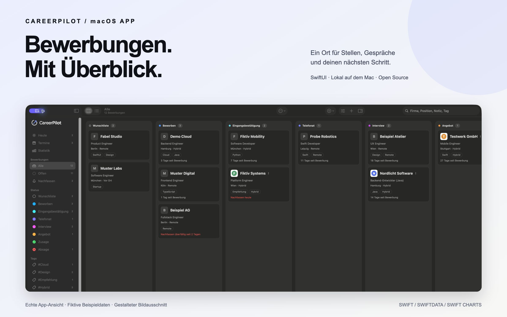
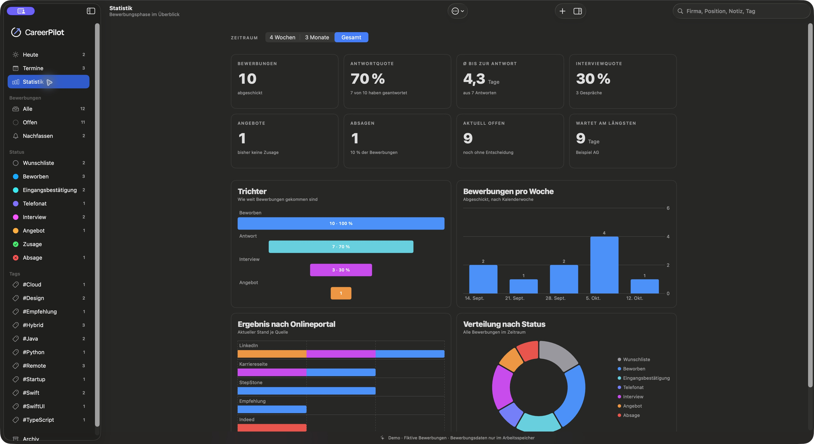
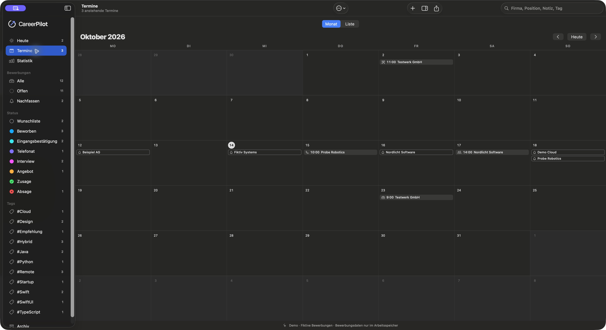

# CareerPilot

Eine ruhige, native macOS-App für deine Bewerbungen: Status im Blick behalten, Nachfass-Termine nicht vergessen und am Ende sehen, wie viele Antworten kamen und wie lange du gewartet hast.

Alle Daten bleiben lokal auf deinem Mac. Es gibt kein Konto, keinen Server und keine Telemetrie.

> **Version 0.1.0** · macOS 26+ · Swift 6 · MIT-Lizenz
> Die App ist noch nicht von Apple signiert, siehe [Installieren](#installieren).



[Board in voller Größe ansehen](docs/images/board.jpg)

Alle gezeigten Bewerbungen, Kontakte und Kennzahlen sind erfundene Beispieldaten.

| Auswertung | Kalender |
| --- | --- |
|  |  |

[Details und Kontakte](docs/images/details.jpg)

## Funktionen

**Bewerbungen verwalten**
- **Board:** Kanban-Spalten mit Drag & Drop, innerhalb einer Spalte umsortierbar. Alternativ per Kontextmenü („Verschieben nach“) oder Tastatur (⌥⌘→ und ⌥⌘←).
- **Liste:** Umschalten zwischen Board und Liste mit ⌘1 und ⌘2.
- **Spalten anpassen:** umbenennen, umsortieren, ausblenden. Die Status haben eigene Farben.
- **Suche** über Firma, Position, Ort, Notizen, Status und Tags.
- **Filter und Ansichten:** nach Priorität, Arbeitsmodell und Onlineportal filtern; Filter lassen sich als Ansicht in der Seitenleiste speichern.
- **Tags**, Archiv, Duplizieren, Beispieldaten über das Menü „Daten“.

**Details zu jeder Bewerbung**
- **Kopf wie bei Notion:** Firmenlogo und der Firmenname groß und fett.
- **Firmenlogo:** Bild aus der Zwischenablage mit ⌘V einfügen (ein Screenshot mit ⌃⇧⌘4 genügt), hineinziehen oder auswählen. Es wird auf 256 Pixel verkleinert und erscheint auf Karten, in der Liste und im Kopf.
- **Stellenanzeige:** Onlineportal (LinkedIn, Indeed, StepStone, XING, Karriereseite, eigener Name) und Link mit Einfügen- und Öffnen-Knopf. Bekannte Portale erkennt die App am Link.
- **Verlauf:** Jeder Statuswechsel wird automatisch protokolliert, eigene Notizen lassen sich ergänzen.
- **Notizen** in Markdown mit Vorschau (Überschriften, Listen, Aufgaben, Zitate, fett/kursiv, Links).
- **Gehaltsrahmen**, Priorität, Arbeitsmodell, Nachfass-Datum.
- **Kontakte** mit E-Mail- und Telefon-Link.
- **Dokumente:** PDFs (Lebenslauf, Anschreiben, Zeugnisse) per Dialog oder Drag & Drop, geprüft auf Endung, PDF-Kopfzeile und Größe (höchstens 20 MB).

**Termine und Erinnerungen**
- **Heute:** überfällige und heutige Nachfass-Termine, Termine der nächsten 7 Tage und Bewerbungen ohne Antwort seit X Tagen.
- **Termine:** Telefonat, Interview, Fachgespräch, Probearbeiten mit Zeit, Ort, Videolink, Ansprechpartner, Vorbereitungs-Checkliste, Fragenliste und Nachbereitung. Monatsansicht und Liste.
- **Erinnerungen:** lokale Benachrichtigungen vor Terminen und am Tag des Nachfassens, optional als tägliche Zusammenfassung (Einstellungen mit ⌘,). Nach X Tagen ohne Antwort schlägt die App ein Nachfass-Datum vor.
- **Kalender-Export** als `.ics`, einzeln oder gesammelt.

**Auswertung und Daten**
- **Statistik:** Anzahl, Antwortquote, Ø Tage bis zur ersten Antwort, Interviewquote, Angebote, Absagen, aktuell offen und wer am längsten wartet. Dazu Trichter, Bewerbungen pro Woche, Ergebnis nach Onlineportal und Verteilung nach Status, für 4 Wochen, 3 Monate oder Gesamt.
- **Export:** CSV für Excel und Numbers (Semikolon, UTF-8) und vollständiges JSON-Backup mit Verlauf, Terminen, Kontakten, Logos und Dokumenten.
- **Import:** fügt hinzu und überspringt Bewerbungen, die es schon gibt.

**Bedienung**
- **Befehlspalette (⌘K):** Bewerbungen, Termine und Ansichten suchen und öffnen, Befehle ausführen.
- **Rückgängig:** ⌘Z und ein Hinweis mit „Rückgängig“ nach Löschen, Verschieben, Archivieren und Logo-Änderung.
- **Start-Animation:** Die Bildmarke zeichnet sich, dann erscheint der Schriftzug, nach etwa drei Sekunden öffnet sich die App. Klick überspringt, bei „Bewegung reduzieren“ bleibt sie kurz, abschaltbar in den Einstellungen.
- Hell- und Dunkelmodus folgen dem System.

## Installieren

CareerPilot ist **nicht von Apple signiert oder notarisiert**. Dafür braucht es das kostenpflichtige
Apple-Developer-Programm. Es gibt deshalb zwei Wege:

**1. Fertige App aus dem Release** (macOS 26 oder neuer)

1. Unter [Releases](../../releases) die Datei `CareerPilot-0.1.0-macOS-unsigned.zip` laden und entpacken.
2. `CareerPilot.app` in den Ordner „Programme“ ziehen.
3. Beim ersten Start meldet macOS, die App könne nicht überprüft werden. Öffne
   **Systemeinstellungen → Datenschutz & Sicherheit**, scrolle nach unten und wähle bei CareerPilot
   **„Trotzdem öffnen“**.
4. Wer sichergehen will, vergleicht die Prüfsumme der Datei mit der in den Release-Notizen:
   `shasum -a 256 CareerPilot-0.1.0-macOS-unsigned.zip`

Deine Bewerbungen liegen danach nur lokal im App-Container
(`~/Library/Containers/app.careerpilot.CareerPilot`). Zum Deinstallieren die App löschen und, wenn
gewünscht, diesen Ordner.

**2. Selbst bauen:** siehe unten, braucht Xcode 26.

## Voraussetzungen

- macOS 26 oder neuer
- Xcode 26 oder neuer (zum Selbstbauen)

## Bauen und starten

```bash
# Repository klonen oder das Quellcode-ZIP entpacken.
# Im Ordner mit der Projektdatei:
open CareerPilot.xcodeproj
```

In Xcode das Schema **CareerPilot** wählen und mit ⌘R starten. Ohne Xcode-Oberfläche:

```bash
xcodebuild -project CareerPilot.xcodeproj -scheme CareerPilot -destination 'platform=macOS' build
```

Eine eigene Release-App samt ZIP und Prüfsumme baust du mit `bash scripts/build-release.sh`. Das Skript
prüft dabei, dass keine lokalen Pfade oder Benutzernamen in der App stehen.

Das Projekt ist ohne Apple-Developer-Account lokal lauffähig (Signatur „Sign to Run Locally“). Zum Weitergeben einer signierten und notarisierten App brauchst du einen eigenen Developer-Account und eine eigene Bundle-ID (derzeit der Platzhalter `app.careerpilot.CareerPilot`).

## Sichere Demo für Screenshots

```bash
bash scripts/build-demo.sh
```

Das Skript gibt den Pfad zur Demo-App aus. Öffne sie im Finder.
Sie verwendet die separate Bundle-ID `app.careerpilot.preview`, lädt zwölf erfundene
Bewerbungen und hält Bewerbungsdaten ausschließlich im Arbeitsspeicher. Beim Beenden
verschwinden Änderungen. Systembenachrichtigungen bleiben deaktiviert, persönliche
Darstellungspräferenzen der regulären App bleiben durch die separate Bundle-ID getrennt.
Der Demo-Hinweis ist in der Oberfläche sichtbar. Es werden keine echten Daten kopiert.

## Entwicklungshilfe

Nur in Debug-Builds, als Startargumente (`open CareerPilot.app --args …`):

| Argument | Wirkung |
| --- | --- |
| `-loadSampleData YES` | füllt einen leeren Speicher mit erfundenen Beispieldaten |
| `-inMemoryStore YES` | temporärer Speicher, echte Daten bleiben unberührt |
| `-startSection agenda` | öffnet direkt eine Ansicht (`agenda`, `calendar`, `statistics`) |
| `-showSplash NO` | überspringt die Start-Animation |

## Tests

```bash
xcodebuild -project CareerPilot.xcodeproj -scheme CareerPilot -destination 'platform=macOS' test
```

Die Tests nutzen Swift Testing und einen Speicher im Arbeitsspeicher; echte Daten werden nie berührt. Beende die App vorher, sonst hängt sich Xcode an den laufenden Prozess.

## Aufbau

```
CareerPilot/
├── CareerPilotApp.swift       App-Einstieg, SwiftData-Container (mit Rückgängig), Einstellungen
├── AppCommands.swift          Menüleiste und Tastenkürzel
├── Models/                    SwiftData-Modelle (JobApplication, TimelineEntry, ApplicationEvent,
│                              ContactPerson, ApplicationDocument), Aufzählungen, Tags, Schema
├── Services/                  Fachlogik ohne Oberfläche: Board-Reihenfolge, Erinnerungen, Agenda,
│                              ICS, Statistik, Backup/CSV, Filter, Befehlspalette, Dokumente, Logos
├── Views/                     Seitenleiste, Board, Liste, Detailformular, Termine, Statistik,
│   ├── Board/                 Karten und Spalten
│   ├── Components/            wiederverwendbare Bausteine (Logo, Tags, Markdown, Hinweis)
│   └── Splash/                Bildmarke und Start-Animation
├── Resources/Fonts/           Manrope (SIL OFL)
└── Assets.xcassets/           App-Symbol
CareerPilotTests/              Tests der Fachlogik
Config/CareerPilot.entitlements
```

Die Fachlogik steckt in reinen Funktionen mit übergebenem „jetzt“ und Kalender und ist ohne Oberfläche testbar.

## Technik-Entscheidungen

- **SwiftUI und SwiftData:** nativ, ohne Fremdabhängigkeiten.
- **Status als Aufzählung mit stabilem Rohwert:** Beschriftungen und Reihenfolge sind anpassbar, ohne Daten zu migrieren.
- **Reihenfolge als `sortIndex`:** Beim Verschieben wird die Zielspalte neu durchnummeriert (`BoardOrdering`).
- **Felder mit Standardwerten:** Sie erleichtern kompatible Schema-Erweiterungen. Änderungen an Beziehungen oder Feldtypen brauchen trotzdem eine geprüfte Migrationsstrategie.
- **Erinnerungsplanung getrennt vom System:** `ReminderPlanner` berechnet reine Werte, `NotificationScheduler` reicht sie nur an macOS weiter. Geplant werden die nächsten 14 Tage, macOS erlaubt höchstens 64 ausstehende Benachrichtigungen.
- **Statistik aus dem Verlauf:** Ob eine Bewerbung je ein Interview erreicht hat, steht im Verlauf, nicht im aktuellen Status. Wartezeiten gibt es nur, wo der Verlauf das Datum kennt.
- **Dokumente und Logos in der Datenbank:** als externes SwiftData-Attribut. So gehören sie zu Rückgängig und Backup, und es gibt keine verwaisten Dateien.
- **Backup ist versioniert und tolerant:** Format und Version stehen im JSON, fehlende Felder bekommen Standardwerte, neuere Dateien werden mit klarer Meldung abgelehnt. Dokumente und Logos aus fremden Dateien durchlaufen dieselbe Prüfung wie beim Hinzufügen.
- **CSV gegen Formeln gesichert:** Felder, die mit `=`, `+`, `-` oder `@` beginnen, bekommen ein Hochkomma.
- **Eigener Markdown-Renderer:** Die Notizen brauchen wenige Blockarten, `AttributedString` übernimmt das Inline-Format.
- **App Sandbox an:** Dateizugriff nur über Auswahl durch den Nutzer.
- **Oberfläche auf Deutsch**, Code und Bezeichner auf Englisch. Übersetzungen über String Catalogs sind willkommen.

## Marke

Logo und App-Symbol stammen aus der Vorlage „CareerPilot Logo dunkel“ (Farben `#0E1116`, `#F7F7F5`, `#7C98FF`). Die Bildmarke ist als Vektorform in `Views/Splash/LogoMark.swift` nachgebaut, das App-Symbol liegt in `Assets.xcassets`. Der Schriftzug nutzt **Manrope** (SIL Open Font License, Lizenztext in `Resources/Fonts/OFL-Manrope.txt`).

## Fahrplan

1. ✅ Gerüst, Datenmodell, Liste mit Anlegen, Bearbeiten, Löschen, Suche
2. ✅ Kanban-Board mit Drag & Drop, Verlauf, Notizen als Markdown, Tags
3. ✅ Erinnerungen, Termine, Kalender- und Listenansicht, `.ics`-Export
4. ✅ Statistik mit Swift Charts
5. ✅ Dokumente, Filter und Ansichten, Befehlspalette, Export und Import, Firmenlogos, Rückgängig-Hinweis
6. Feinschliff: Barrierefreiheit (VoiceOver, Tastatur, Kontrast), Hellmodus durchgehen, signierte und notarisierte Releases

## Datenschutz

CareerPilot hat keinen eigenen Server, keine Analyse und keine Zugangsdaten. Backups (JSON, CSV) sind
Klartext und nicht verschlüsselt; bitte nicht in öffentliche Issues hochladen. Mehr dazu in
[SECURITY.md](SECURITY.md).

## Lizenz

[MIT](LICENSE)
